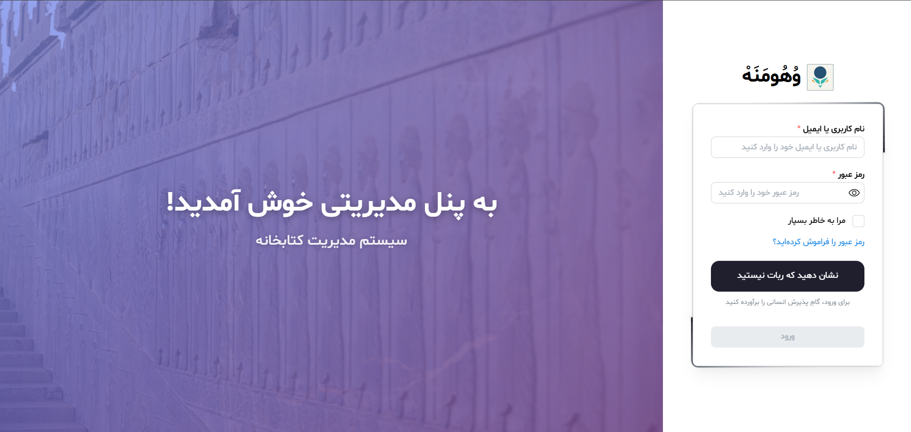
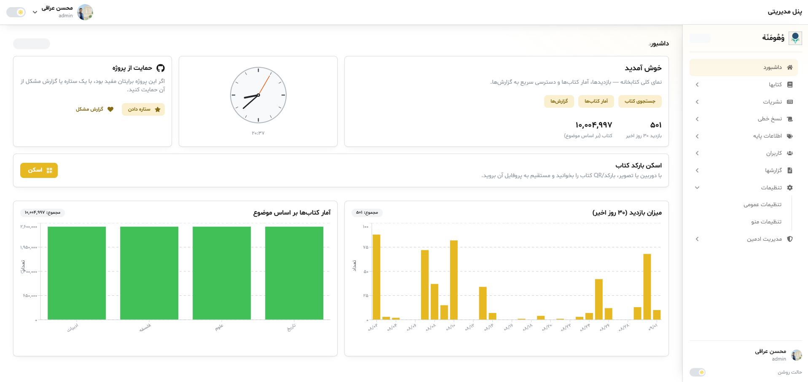

# VohuManah

A digital library management system — a unified solution for libraries, archives and documentation centers to manage books, manuscripts and publications.


## What it does

VohuManah brings the full workflow of a library into a single environment — from recording bibliographic details and preparing digital copies to searching, statistics and reporting.

Its three core modules:

- **Books** — bibliographic data, volumes, attachments, cover images and digital file archiving
- **Manuscripts** — managing handwritten manuscripts, place of writing, script gap and attributes of historical documents
- **Publications** — periodicals and journals with type, place of printing and language

Supporting tools are built into the system as well: publishers, cities, languages, subjects and user management; advanced search with combined filters; and a dashboard for monitoring the data.

## Screenshots

Main dashboard — an overview of activity and statistics:



Books page — list, search and editing operations:



## Key features

- **Combined search** — filter simultaneously by title, subject, language, publisher, place and publication year, with full Persian support
- **Digital files** — upload and manage multiple files per work in various formats (PDF, Word, Excel, images)
- **Barcode & QR** — scan to reach works quickly
- **Reporting** — PDF and Excel export from tables and statistics, with full right-to-left layout support
- **Interactive charts** — statistics across books, manuscripts and publications
- **Access control** — roles and permission levels for users across sections
- **Dynamic menu** — visually arrange and personalize the UI menu
- **Persian (Shamsi) calendar** — all dates are stored and displayed in Shamsi throughout the system

## Architecture

The project follows **Clean Architecture** with the **CQRS** pattern and a strict separation of layers:

```
┌──────────────────────────────────────────────────────────────┐
│                        Web.UI (React)                        │
└──────────────────────────────┬───────────────────────────────┘
                               │ REST / JSON
┌──────────────────────────────▼───────────────────────────────┐
│                    Web.Api (REST API)                         │
├──────────────────────────────────────────────────────────────┤
│   Application (CQRS: Command/Query/Handler/Validator)         │
├──────────────────────────────────────────────────────────────┤
│   Domain (Entities / Rules / Errors)                          │
├──────────────────────────────────────────────────────────────┤
│   Infrastructure (EF Core / JWT / File Storage / Reports)     │
└──────────────────────────────────────────────────────────────┘
                               │
                    ┌──────────▼──────────┐
                    │  SQL Server (DB)    │
                    └─────────────────────┘
```

Layers:

- **Domain** — the core: entities, business rules and domain-specific errors, with no external dependencies
- **Application** — CQRS implementation: commands, queries, handlers and validation (FluentValidation)
- **Infrastructure** — data access (Entity Framework Core), JWT authentication, file storage and the reporting engine
- **Web.Api** — the presentation layer as a REST API with discoverable endpoints
- **Web.UI** — the web UI (React), talking to the backend over the API

## Technology stack

| Area | Technology |
|---|---|
| Language & platform | C# 13 / .NET 10 |
| Architecture pattern | Clean Architecture + CQRS |
| Data access | Entity Framework Core + SQL Server |
| Authentication | JWT |
| Validation | FluentValidation |
| Frontend | React 19 + TypeScript 6 |
| Component library | Mantine 9 |
| Charts | Recharts |
| Build tool | Vite (Rolldown) |
| Reporting/export | jsPDF + RDLC |
| Containerization | Docker Compose |

## Quick start

The project runs with Docker Compose:

```bash
docker compose up -d --build
```

After startup:
- UI: `http://localhost:5002`
- API: `http://localhost:5000`
- Test login: `admin / admin123`

## Project structure

```
VohuManah.Core/
├── src/
│   ├── Domain/            # entities and domain rules
│   ├── Application/       # application layer (CQRS)
│   ├── Infrastructure/    # EF Core, auth, files, reports
│   ├── SharedKernel/      # shared primitives (Result, Error)
│   ├── External/          # reporting engine (RDLC)
│   ├── Web.Api/           # REST API
│   └── Web.UI/            # React UI
├── docker/                # Docker Compose setup
├── docs/                  # documentation and screenshots
└── VohuManah.slnx
```

## License

Distributed under the **GPL-3.0** license. See `COPYING` for details.
