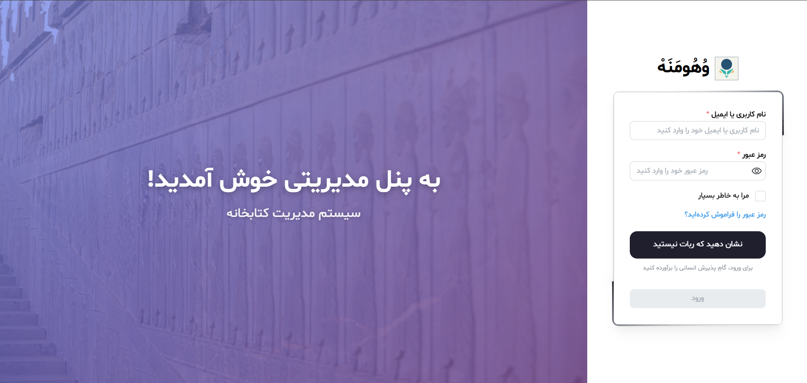
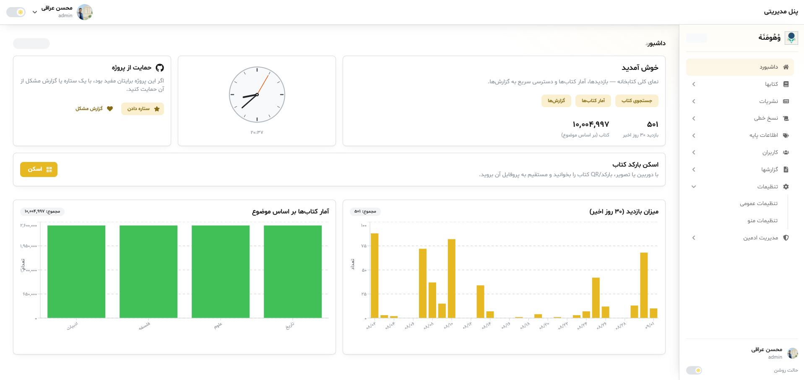

# وهومنه

سیستم مدیریت کتابخانه دیجیتال — راهکاری یکپارچه برای کتابخانه‌ها، مراکز اسناد و پایگاه‌های اطلاعاتی برای مدیریت کتاب‌ها، نسخ خطی و نشریات.


## این نرم‌افزار چکار می‌کند؟

وهومنه برای این ساخته شده که زنجیرهٔ کامل کار یک کتابخانه را در یک محیط واحد جمع کند — از ثبت اطلاعات کتاب و تهیهٔ نسخه دیجیتال تا جستجو، آمار و گزارش‌گیری.

سه هستهٔ اصلی آن:

- **کتاب‌ها** — اطلاعات کتابشناختی، جلدها، پیوست‌ها، تصویر جلد و بایگانی فایل‌های دیجیتال
- **نسخ خطی** — مدیریت نسخ بدخط، محل نگارش، فاصله و مشخصات ویژهٔ اسناد تاریخی
- **نشریات** — ثبت مجله‌ها و نشریات دوره‌ای به همراه نوع، محل چاپ و زبان

علاوه بر این، ابزارهای پشتیبان هم در دل سیستم ساخته شده: مدیریت ناشران، شهرها، زبان‌ها، موضوعات و کاربران؛ جستجوی پیشرفته با فیلترهای ترکیبی؛ و صفحهٔ داشبورد برای پایش داده‌ها.

## تصاویری از محیط برنامه

داشبورد اصلی — نمای کلی فعالیت‌ها و آمار:



صفحهٔ مدیریت کتاب‌ها — فهرست، جستجو و عملیات ویرایش:



## ویژگی‌های کلیدی

- **جستجوی ترکیبی** — فیلتر همزمان بر پایهٔ عنوان، موضوع، زبان، ناشر، مکان و سال انتشار با پشتیبانی کامل فارسی
- **فایل‌های دیجیتال** — بارگذاری و مدیریت چند نسخه برای هر اثر با فرمت‌های مختلف (PDF، Word، اکسل و تصویر)
- **بارکد و QR** — اسکن بارکد/QR برای دسترسی سریع به آثار
- **گزارش‌گیری** — خروجی PDF و اکسل از جداول و آمار، با پشتیبانی کامل چیدمان راست‌به‌چپ
- **نمودارهای تعاملی** — وابسته به آمار کتاب، نسخ خطی و نشریات
- **مدیریت دسترسی** — نقش‌ها و سطح دسترسی کاربران به بخش‌های گوناگون
- **منوی پویا** — چینش و شخصی‌سازی منوی کاربری به‌صورت بصری
- **پشتیبانی از تاریخ شمسی** — تمام تاریخ‌ها در سراسر سیستم به‌صورت شمسی نگهداری و نمایش داده می‌شود

## معماری

پروژه بر پایهٔ **Clean Architecture** با الگوی **CQRS** و تفکیک کامل لایه‌ها طراحی شده:

```
┌──────────────────────────────────────────────────────────────┐
│                        Web.UI (React)                        │
└──────────────────────────────┬───────────────────────────────┘
                               │ REST / JSON
┌──────────────────────────────▼───────────────────────────────┐
│                    Web.Api (REST API)                         │
├──────────────────────────────────────────────────────────────┤
│   Application (CQRS: Command/Query/Handler/Validator)         │
├──────────────────────────────────────────────────────────────┤
│   Domain (Entities / Rules / Errors)                          │
├──────────────────────────────────────────────────────────────┤
│   Infrastructure (EF Core / JWT / File Storage / Reports)     │
└──────────────────────────────────────────────────────────────┘
                               │
                    ┌──────────▼──────────┐
                    │  SQL Server (DB)    │
                    └─────────────────────┘
```

لایه‌ها:

- **Domain** — هستهٔ دامنه: موجودیت‌ها، منطق تجاری و خطاهای تخصصی، بدون هیچ وابستگی بیرونی
- **Application** — پیاده‌سازی CQRS: فرمان‌ها، پرس‌وجوها، هندلرها و اعتبارسنجی (FluentValidation)
- **Infrastructure** — دسترسی به داده (Entity Framework Core)، احراز هویت JWT، ذخیره‌سازی فایل و موتور گزارش‌گیری
- **Web.Api** — لایهٔ ارائه به شکل REST API با نقطه‌پایان قابل کشف
- **Web.UI** — رابط کاربری تحت وب (React) که از طریق API با پشتیبان در ارتباط است

## تکنولوژی‌های استفاده شده

| بخش | تکنولوژی |
|---|---|
| زبان و پلتفرم | C# 13 / .NET 10 |
| الگوی معماری | Clean Architecture + CQRS |
| دسترسی به داده | Entity Framework Core + SQL Server |
| احراز هویت | JWT |
| اعتبارسنجی | FluentValidation |
| رابط کاربری | React 19 + TypeScript 6 |
| کتابخانهٔ کامپوننت | Mantine 9 |
| نمودارها | Recharts |
| ابزار ساخت | Vite (Rolldown) |
| گزارش/اکسپورت | jsPDF + RDLC |
| کانتینرسازی | Docker Compose |

## شروع سریع

پروژه با Docker Compose بالا می‌آید:

```bash
docker compose up -d --build
```

پس از بالا آمدن:
- رابط کاربری: `http://localhost:5002`
- API: `http://localhost:5000`
- تست ورود: `admin / admin123`

## ساختار پروژه

```
VohuManah.Core/
├── src/
│   ├── Domain/            # موجودیت‌ها و قواعد دامنه
│   ├── Application/       # لایهٔ کاربردی (CQRS)
│   ├── Infrastructure/    # EF Core، احراز هویت، فایل، گزارش
│   ├── SharedKernel/      # الگوهای مشترک (Result، Error)
│   ├── External/          # موتور گزارش‌گیری (RDLC)
│   ├── Web.Api/           # REST API
│   └── Web.UI/            # رابط کاربری React
├── docker/                # تنظیمات Docker Compose
├── docs/                  # مستندات و اسکرین‌شات‌ها
└── VohuManah.slnx
```

## مجوز

توزیع‌شده تحت مجوز **GPL-3.0**. برای جزئیات، فایل `COPYING` را ببینید.
